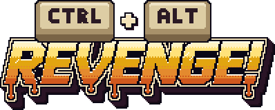
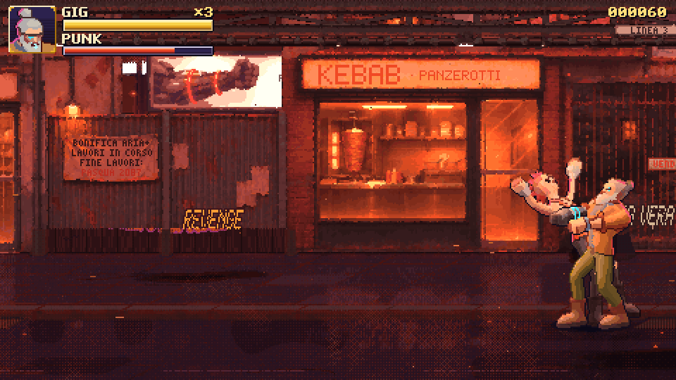
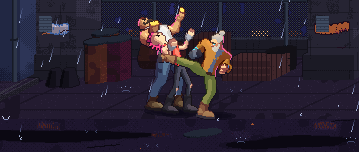
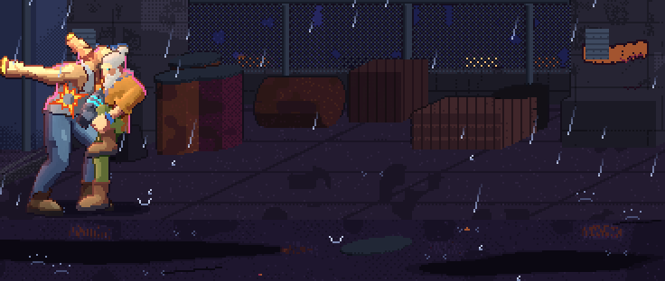
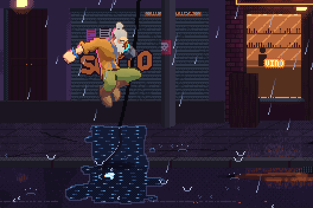
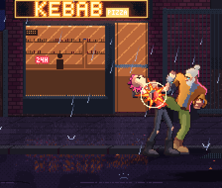

<p align="center">
  
</p>

<p align="center">
  <strong>Platform d’azione in pixel art, ambientato a Taranto nel 2087.</strong><br>
  In sviluppo con Godot 4.7.2.
</p>

<p align="center">
  <a href="https://luigismith.github.io/ctrl-alt-revenge/"><strong>Il sito</strong></a> ·
  <a href="https://luigismith.github.io/ctrl-alt-revenge/gioca/"><strong>Gioca la demo nel browser</strong></a> ·
  <a href="https://luigismith.github.io/ctrl-alt-revenge/en/">English</a>
</p>

<p align="center">
  
</p>

> **Taranto, 2087. Il braccio è in abbonamento. La vendetta no.**

<p align="center">
  
  
</p>
<p align="center">
  
  
</p>

## La storia

Sopra la vecchia fabbrica ci sono le cupole bianche di SIDERA: sotto, dicono, c’è la bonifica, e a Pasqua la città sarà finalmente pura.

Cataldo Gigante, per tutti GIG, è l’ingegnere dei Tamburi che ha progettato MANODOPERA, il braccio cibernetico che ridava un braccio agli operai che l’avevano perso sul lavoro, e che oggi SIDERA dà in abbonamento. Dopo la morte di Mimmo, il suo amico di sempre, GIG ha fatto troppe domande: in una settimana ha perso lavoro, casa e nome sui brevetti, e il suo braccio è stato bloccato a distanza con due parole: «Abbonamento scaduto».

Giovedì Santo, ore 15. Mentre i perdoni escono dal Carmine, due Esattori raggiungono GIG al cimitero di San Brunone, sulla tomba di Mimmo, per pignorargli il braccio. GIG scappa nel garage della madre, collega al braccio la vecchia tastiera del padre e preme CTRL+ALT+CANC, due tasti con l’unica mano buona e il terzo col naso. Il braccio si riavvia e parla, l’occhio diventa cyan, e con il primo doppio salto comincia la sua notte sola, dal pomeriggio sui tetti dei Tamburi, dove gli fa da guida Totò, undici anni, che dipinge REVENGE sui muri.

Tutto succede fra il Giovedì e il Venerdì Santo, 17–18 aprile 2087: la notte dei perdoni e dell’Addolorata, la più antica della città. Nel 2087 a Taranto è cambiato quasi tutto, tranne questo.

## Il gioco

- **Platform e botte, nella stessa notte.** Si corre e si salta in 2D laterale; quando arrivano gli Esattori la telecamera si inclina, il pavimento si allarga e si combatte in profondità. A scontro finito compare VAI e si torna a saltare.
- **Botte con il peso giusto.** Jab, jab, gancio cyber e calcio, solo se il colpo va a segno; prese con ginocchiate e proiezioni, calcio volante.
- **Acrobazie di una volta, comodità di oggi.** Doppio salto, sporgenze, salti a muro, scatti, corse sui muri e, più avanti, il Rampino.
- **Il braccio si collega.** Puzzle di hacking a tempo dentro il livello, sui pannelli che la Vista, l’occhio cyan di GIG, rivela.
- **La Vista e i segreti.** Muri finti, piattaforme invisibili, registri delle braccia nascosti, le firme di Totò da collezionare.
- **Taranto da giocare.** Luoghi veri, e il cibo della città come recupero: taralli, il caffè del MiniBar di Ignazio, il panzerotto e, rara, la scarcella di Pasqua. Checkpoint frequenti e niente GAME OVER; per chi vuole il brivido, la modalità arcade con il CONTINUA?

Nello slice di oggi ci sono la corsa, il salto, il cavo da saltare, le combo, le prese, le proiezioni, il calcio volante e l’arena; il resto è in sviluppo. Il sito dice pilastro per pilastro che cosa c’è già e che cosa no.

**Retro, con la tecnologia di oggi.** La pixel art è lo stile, non un limite d’epoca: 480×270 pixel ingranditi a multipli interi (×4 su uno schermo 1080p), luci dinamiche con le normal map, particelle, hitstop e rallentatore sull’ultimo KO. Le scene a fumetto sono i murales di Totò.

## Stato

In sviluppo, novembre 2026. Il gioco si sta rifacendo da zero in Godot 4.7.2, prima per Windows. La versione precedente, in Python/Pygame, è archiviata nel ramo [`legacy-pygame`](https://github.com/luigismith/ctrl-alt-revenge/tree/legacy-pygame).

| Tappa | Stato |
|---|---|
| La storia, dall’inizio alla fine, con gli intermezzi a fumetto | fatta |
| Le basi del gameplay: platform e arene, mosse, combattimento, puzzle di hacking, recuperi, segreti | fatte |
| Una ricerca su Taranto con le fonti, e una cronologia che tiene coerenti luoghi, date, ore, meteo e luna | fatta |
| Lo slice verticale «Sotto la Linea», giocabile dal titolo alla fine della demo | fatto |
| La stanza di prova per tarare le mosse: corsa, salto, Spinta, piattaforme sottili, sporgenze, scivolata, salto a muro, scatto e corsa sui muri | in corso |
| Il prologo (il cimitero di San Brunone e il garage) e il capitolo 1, «I tetti dei Tamburi» | poi |
| La prova di stile dei murales e la colonna sonora (i primi due brani sono già nella demo) | in parallelo |

Lo slice è una prova tecnica: la sua strada è ancora generica, e la rifaremo perché racconti i Tamburi la sera del Giovedì Santo del 2087. Nessuna data di uscita, per ora: tappe, stime in ore e cosa blocca cosa sono nel [piano](docs/piano.md). La specifica dello slice è in [`docs/specifica-slice.md`](docs/specifica-slice.md).

## Come provarlo

**Nel browser:** [luigismith.github.io/ctrl-alt-revenge/gioca](https://luigismith.github.io/ctrl-alt-revenge/gioca/), da computer, con la tastiera o con un controller. C’è anche la musica: il tema del titolo, «Sotto la Linea» con la batteria che entra nelle arene e il jingle di ZONA LIBERATA.

**Dal codice:** serve [Godot 4.7.2](https://godotengine.org/download/archive/4.7.2-stable/), nella versione standard e non .NET. Dalla cartella del repository:

```
godot --headless --path game --import
godot --path game
```

Il primo comando importa gli asset (serve la prima volta e dopo ogni aggiornamento della grafica o dei suoni), il secondo apre il gioco in una finestra 1440×810, cioè tre volte la risoluzione interna 480×270.

Sul PC di sviluppo, con il laboratorio in `%USERPROFILE%\ctrlaltrevenge-lab\`, basta un doppio clic su `Gioca.bat` in quella cartella: importa il progetto e avvia il gioco.

Argomenti utili, da scrivere dopo `--`:

| Argomento | Effetto |
|---|---|
| `--autostart` | salta il titolo e parte dal livello |
| `--stanza` | parte dalla stanza di prova in grigio (anche dal titolo: STANZA DI PROVA) |
| `--autopilot stanza` | GIG percorre da solo la stanza di prova |
| `--replay res://tests/replays/demo.json` | riproduce la dimostrazione di circa 67 s (GIG gioca da solo) |
| `--start-x 1150` | fa partire GIG da quel punto del livello (qui: prima del cavo) |
| `--debug-boxes` | mostra hitbox e hurtbox, come F1 |
| `--no-lights` | parte con le luci dinamiche spente, come F5 |

Per esempio `godot --path game -- --autostart`. Gli altri argomenti sono descritti in [`game/tests/README.md`](game/tests/README.md).

La musica non è in questo repository (vedi sotto). Il gioco la cerca in `game/assets_private/music/`, in `music/` accanto all’eseguibile e, solo durante lo sviluppo (non nelle build esportate), in `%USERPROFILE%\ctrlaltrevenge-lab\music\`; senza musica funziona lo stesso, solo che è muto.

## Comandi

| Azione | Tastiera | Gamepad |
|---|---|---|
| Muoversi (anche in profondità) | frecce oppure W A S D | croce direzionale oppure levetta sinistra |
| Correre | due tocchi rapidi verso destra o sinistra | due tocchi rapidi verso destra o sinistra |
| Attacco | J oppure Z | X oppure Y (Quadrato o Triangolo) |
| Salto | K oppure X | A oppure B (Croce o Cerchio) |
| Scatto (stanza di prova) | L oppure C | un dorsale (L1 o R1) |
| Pausa | Esc oppure Invio | Start (Options) |
| Confermare nei menu | Invio, Spazio, J oppure Z | A oppure Start |
| Tornare indietro nei menu | Esc oppure Backspace | B |

Le mosse dello slice:
- **Combo**: premendo attacco, jab, jab, gancio cyber e calcio finale si concatenano solo se il colpo precedente va a segno; a vuoto GIG ripete il primo jab.
- **Calcio volante**: attacco durante il salto.
- **Presa**: si cammina contro un nemico vicino, nella sua stessa corsia. Dalla presa, attacco dà una ginocchiata (al massimo due); il terzo attacco, oppure attacco più la direzione opposta, lo proietta. Il corpo proiettato atterra gli altri nemici.
- **Ostacolo**: il cavo nella pozzanghera si salta; toccarlo fa 10 di danno e atterra.

Nella stanza di prova, che c'è solo nelle versioni per PC:
- **Spinta**: il doppio salto, cioè salto premuto di nuovo in aria; il braccio scarica verso il basso.
- **Piattaforme sottili**: si sale da sotto; giù più salto per scendere.
- **Sporgenze**: cadendo verso un muro GIG si aggrappa; su, salto o la direzione del muro per salire, giù per lasciarsi.
- **Scivolata**: giù mentre si corre, o giù con una direzione anche da fermi; giù da solo per accovacciarsi, poi la direzione per camminare accovacciati.
- **Salto a muro**: cadendo contro un muro GIG pianta il braccio e frena; salto lo stacca in diagonale. Fra due muri vicini si risale.
- **Scatto**: in aria, il tasto dello scatto spinge GIG in avanti di 3 blocchi, dritto; uno per salto.
- **Corsa sul muro**: di corsa contro un muro, salto: GIG sale qualche passo in verticale; in cima, salto di nuovo è la Spinta.
- **R** (Select sul gamepad) ricomincia dall'inizio, **Esc** (Start) torna al titolo; in basso ci sono velocità, altezza dell'ultimo salto e tick in aria, per tarare il movimento.

Avviando il gioco con Godot, come sopra, è una build di debug e funzionano anche F1 (hitbox e hurtbox), F2 (rallentatore), F3 (fermo immagine), F4 (avanza di un fotogramma durante il fermo immagine) e F5 (accende e spegne le luci dinamiche sui personaggi). Nelle build esportate per i giocatori, e nella demo web, questi tasti non fanno nulla.

## Test

```
tools/run_godot.sh 120 --headless --import
REQUIRE_DONE=1 tools/run_godot.sh 300 --headless -s res://tests/run_tests.gd
REQUIRE_DONE=1 tools/run_godot.sh 120 --headless -s "$(cygpath -w "$PWD/tools/audio/godot_tests/test_audio.gd")"
```

Il gioco gira a tick fissi, senza tempo reale: i test costruiscono un livello e lo fanno avanzare un tick alla volta, e i replay (solo gli ingressi, tick per tick) si rigiocano due volte per controllare che lo stato finale abbia lo stesso hash. L’ultima riga dell’output è `DONE` solo se tutti i test passano. Gruppi, replay e controllo visivo con Movie Maker sono descritti in [`game/tests/README.md`](game/tests/README.md).

Prima di ogni commit gira `tools/guard_assets.py`, tramite l’hook in `tools/hooks`.

## Il sito

Il sito sta in `site/` (testi in `site/content/it.json` ed `en.json`, modello in `site/modello/`) e si costruisce con la sola libreria standard di Python:

```
python -I tools/site/build.py              # in _site/; si ferma se trova spoiler, risorse esterne o link rotti
python -I tools/site/media.py              # rifà video, GIF, schermate e sprite del sito dal gioco vero
bash tools/site/export_web.sh              # esporta la demo web (Godot 4.7.2, senza thread; con la musica se CAR_MUSIC_DIR indica i brani)
```

Su GitHub fa tutto il workflow [`.github/workflows/sito.yml`](.github/workflows/sito.yml), a ogni push su `master` che tocca il sito o il gioco: costruisce il sito, scarica la musica della demo dalla release [`musica-demo`](https://github.com/luigismith/ctrl-alt-revenge/releases/tag/musica-demo), esporta la demo in `gioca/` e pubblica su GitHub Pages. Niente CDN, niente cookie, niente tracciamenti.

## Struttura

| Cartella | Contenuto |
|---|---|
| `game/` | Progetto Godot: scene, script, dati, asset, test e replay |
| `tools/` | Pipeline per sprite e sfondi (dal 3D alla pixel art), effetti visivi, interfaccia e font, effetti sonori e musica, controlli sugli asset, il sito |
| `site/` | Il sito: testi, modello, stile, script e media presi dal gioco |
| `docs/` | Piano, specifica dello slice, media del README, guida per lavorare da più PC |
| `.github/workflows/` | La pubblicazione del sito e della demo |

## Crediti

**CTRL+ALT REVENGE!** · © 2026 Luigi Massari

- **Progetto e direzione:** Luigi Massari.
- **Codice, grafica ed effetti sonori:** prodotti con agenti di intelligenza artificiale per Luigi Massari, partendo da sorgenti CC0.
- **Musica della demo:** Luigi Massari, con Suno (piano Pro).
- **Font CAR Pixel, effetti e interfaccia:** disegnati da script per CTRL+ALT REVENGE.
- **Motore:** [Godot Engine](https://godotengine.org).

Nessuna immagine è generata da un’intelligenza artificiale: la grafica la fanno script deterministici, con semi fissi, che si possono rileggere tutti nel repository; gli script li scrivono agenti AI per Luigi Massari. Niente ritocchi a mano.

**Sorgenti CC0** (il credito non è obbligatorio, lo diamo lo stesso):
- [Quaternius](https://quaternius.com): Universal Base Characters, Universal Animation Library e Universal Animation Library 2 (i modelli e le animazioni da cui nascono GIG, il punk e il bruto), Downtown City MegaKit (il condizionatore a muro).
- [Mesh2Motion](https://github.com/Mesh2Motion/mesh2motion-app): le animazioni del calcio circolare di GIG.
- [Kenney](https://kenney.nl/assets/city-kit-roads): City Kit Roads 2.2, il cassonetto del vicolo.
- [Luis Zuno (ansimuz)](https://opengameart.org/content/warped-city): Warped City; il cielo e i piani lontani di «Sotto la Linea» ne sono una versione ricolorata e ricomposta.

**Strumenti, tutti gratuiti e open source:** Godot Engine 4.7.2 (MIT), Blender 4.5 LTS (GPL-3.0-or-later), FFmpeg 9.0 (GPL-3.0, solo per catture e video), Python 3.14 con NumPy, Pillow e SciPy.

CTRL+ALT REVENGE è un’opera di fantasia, ambientata in una Taranto del 2087 immaginata a partire da quella vera. SIDERA, ARIA+, MANODOPERA e tutti i personaggi sono inventati. I luoghi e i riti della città sono veri, e li raccontiamo con rispetto.

## Licenze

- **Codice** (GDScript, Python, shader, configurazione e codice del sito): [MIT](LICENSE).
- **Asset originali** (grafica, animazioni, sfondi, font CAR Pixel, interfaccia, effetti sonori, livelli, storia e personaggi, comprese le immagini del sito e di questo README): tutti i diritti riservati, compreso il divieto di usarli per addestrare sistemi di intelligenza artificiale. Vedi [`LICENSES/LicenseRef-CAR-Assets.txt`](LICENSES/LicenseRef-CAR-Assets.txt). La licenza MIT non si applica a questi file.
- **Script per Blender** in `tools/blender/`: GPL-3.0-or-later.
- **Materiale di terze parti**: [`THIRD-PARTY-NOTICES.md`](THIRD-PARTY-NOTICES.md).

[`REUSE.toml`](REUSE.toml) dice quale licenza vale per ogni file. Per chiedere un permesso: [GitHub issues](https://github.com/luigismith/ctrl-alt-revenge/issues).

**Musica.** I brani della demo li ha creati Luigi Massari con Suno (piano Pro). Non sono in questo repository e le licenze qui sopra non valgono per loro: la demo web li prende dagli allegati della release [`musica-demo`](https://github.com/luigismith/ctrl-alt-revenge/releases/tag/musica-demo).

**Contributi.** Leggi [`CONTRIBUTING.md`](CONTRIBUTING.md).
